# TP1 — Microservice Spring Boot : Gestion des comptes bancaires

**Filière :** BDCC II · **Module :** Architecture des Systèmes Distribués (JEE & Middlewares)
**Encadrant :** Pr. Mohamed YOUSSFI · **Réalisé par :** Mohammed EL HIMAR · **Date :** Octobre 2026

---

## 1. Objectif

Concevoir un microservice Spring Boot de gestion de comptes bancaires, en couches :

**Repository JPA (H2)** → **Service (DTO / Mapper)** → **Web : REST, Spring Data REST, GraphQL**

## 2. Mise en place

- Projet généré sur start.spring.io : Spring Web, Spring Data JPA, H2, Lombok
- Configuration (`application.properties`) :

```properties
spring.datasource.url=jdbc:h2:mem:account-db
spring.h2.console.enabled=true
spring.graphql.graphiql.enabled=true
```

## 3. Entité JPA et Repository

Le champ `type` est stocké en entier par défaut. On ajoute `@Enumerated(EnumType.STRING)` pour le stocker en texte lisible :

```java
@Enumerated(EnumType.STRING)
private AccountType type;
```

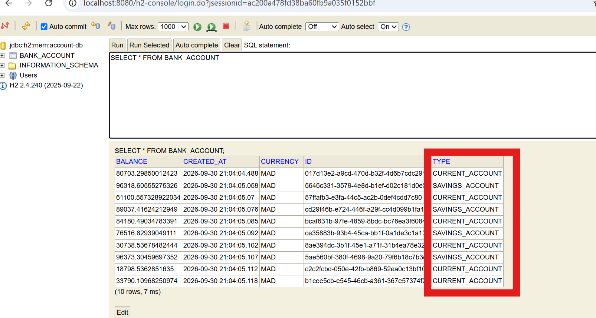

Le repository ne contient aucun code : Spring Data génère le CRUD.

```java
public interface BankAccountRepository extends JpaRepository<BankAccount, String> {}
```

Un `CommandLineRunner` insère 10 comptes au démarrage, puis la console H2 les affiche :

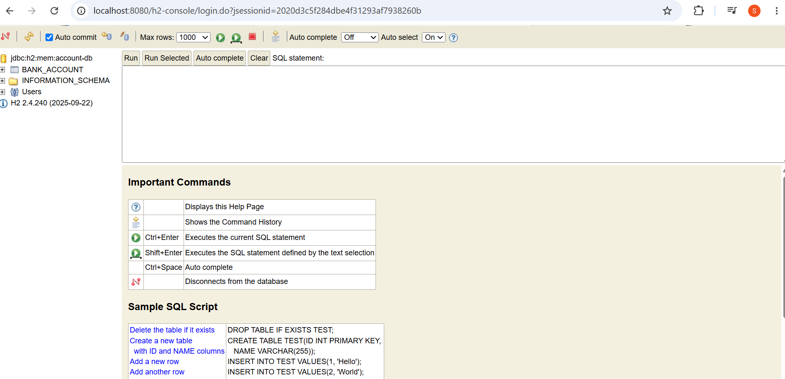

## 4. Web Service REST

Contrôleur `AccountRestController` sous `/api` :

| Méthode | URL | Description |
|---|---|---|
| `GET` | `/api/bankAccounts` | Liste des comptes |
| `GET` | `/api/bankAccounts/{id}` | Détail d'un compte |
| `POST` | `/api/bankAccounts` | Création (ID généré côté serveur) |
| `PUT` | `/api/bankAccounts/{id}` | Mise à jour partielle |
| `DELETE` | `/api/bankAccounts/{id}` | Suppression |

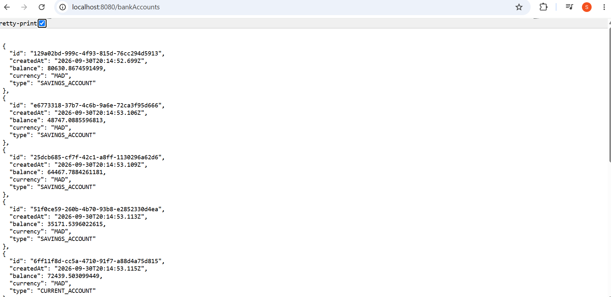

Tests Postman (POST) et documentation Swagger (`/swagger-ui.html`, via SpringDoc) :

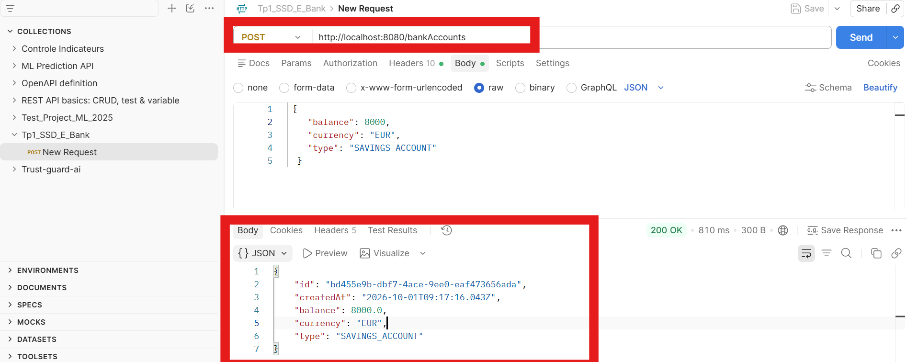

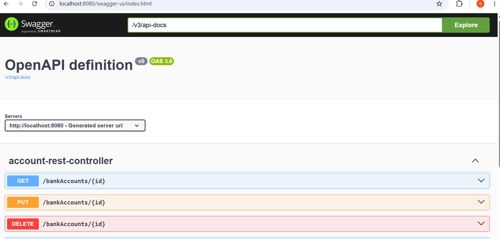

## 5. Spring Data REST et projections

Ajout de `@RepositoryRestResource` sur le repository : CRUD, pagination et liens HATEOAS sont générés sans contrôleur, sur `/bankAccounts`.

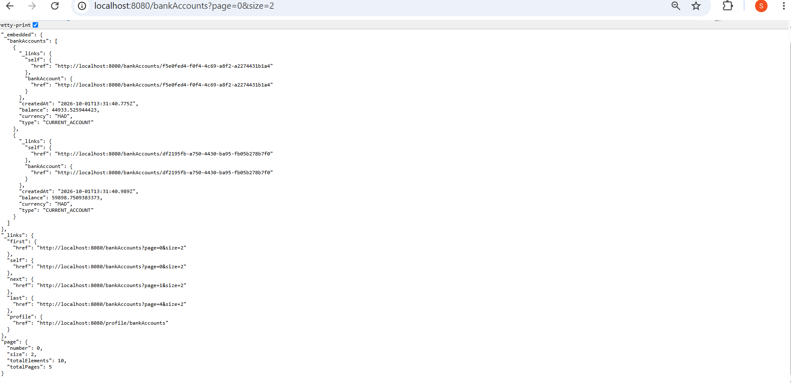

Une projection choisit les champs exposés côté serveur, et un alias rend l'URL de recherche plus courte (`/search/byType?t=...`) :

```java
@Projection(types = BankAccount.class, name = "p1")
public interface BankAccountProjection {
    String getId();
    AccountType getType();
}
```

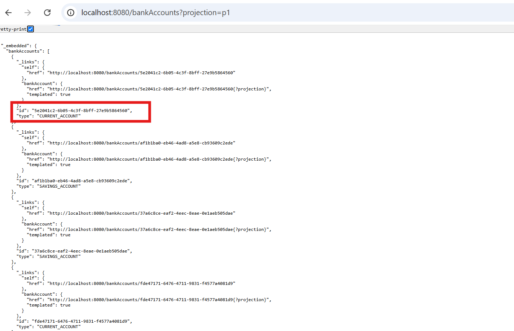

## 6. DTOs et Mapper

Les entités ne sont pas exposées directement. Le client envoie un `BankAccountRequestDTO` (sans `id` ni `createdAt`), et reçoit un `BankAccountDTOResponse` construit par `AccountMapper` dans la couche `AccountServiceImpl` (annotée `@Service` et `@Transactional`).

## 7. Web Service GraphQL

Schéma dans `src/main/resources/graphql/schema.graphqls`, contrôleur `BankAccountGraphQLController` annoté `@Controller`, `@QueryMapping` et `@MutationMapping`.

Le client choisit les champs qu'il veut recevoir :

```graphql
query {
  accountsList { id balance }
}
```

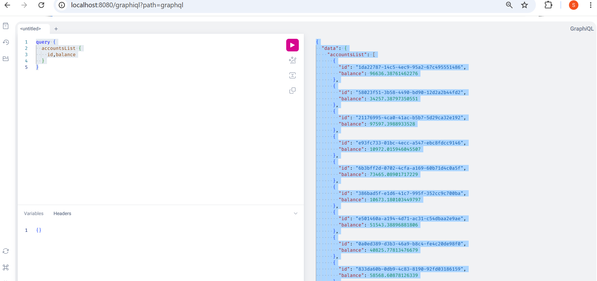

Interface GraphiQL : `http://localhost:8080/graphiql`

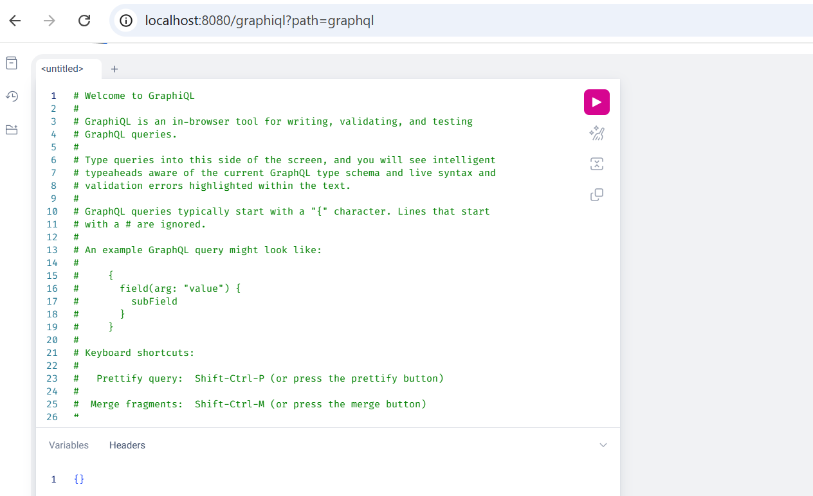

Mutation `addAccount` :

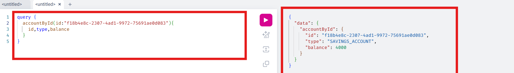

**Gestion des erreurs :** un `DataFetcherExceptionResolverAdapter` renvoie le message exact de l'exception au lieu d'un `Internal Server Error` générique.

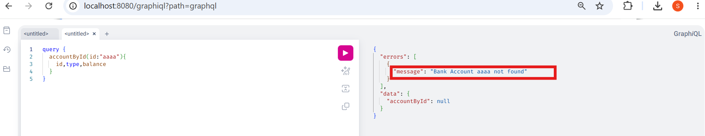

## 8. Entité Customer et relations

`Customer` est lié à ses comptes par une relation `@OneToMany`. Cette relation bidirectionnelle provoque une boucle infinie de sérialisation en REST, corrigée par `@JsonProperty(access = WRITE_ONLY)`. GraphQL n'est pas concerné, car il ne renvoie que les champs demandés.

```java
@OneToMany(mappedBy = "customer")
@JsonProperty(access = JsonProperty.Access.WRITE_ONLY)
private List<BankAccount> bankAccounts;
```

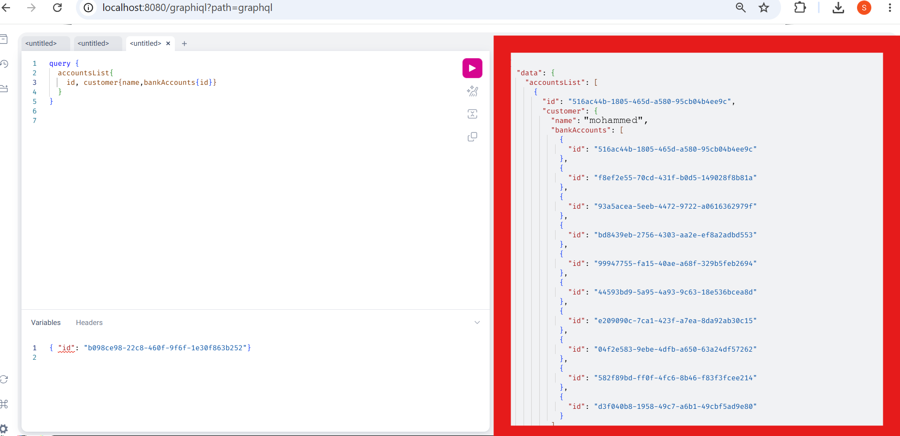


## 9. Comparaison

| Critère | REST | Spring Data REST | GraphQL |
|---|---|---|---|
| Code | Contrôleur manuel | Aucun | Schéma + contrôleur |
| Choix des champs | Non (tout retourné) | Projection (serveur) | Requête (client) |
| Documentation | Swagger / OpenAPI | Automatique | Schéma `.graphqls` |
| Relations | Risque de boucle | Liens HATEOAS | Navigation dans le graphe |

**Conclusion :** REST pour les API publiques, Spring Data REST pour un CRUD rapide, GraphQL pour les interfaces qui ont besoin de données flexibles.

---

## Lancer le projet

```bash
./mvnw spring-boot:run
```

| Outil | URL |
|---|---|
| API REST | `http://localhost:8080/api/bankAccounts` |
| Spring Data REST | `http://localhost:8080/bankAccounts` |
| Swagger UI | `http://localhost:8080/swagger-ui.html` |
| GraphiQL | `http://localhost:8080/graphiql` |
| Console H2 | `http://localhost:8080/h2-console` (JDBC `jdbc:h2:mem:account-db`, user `sa`) |
